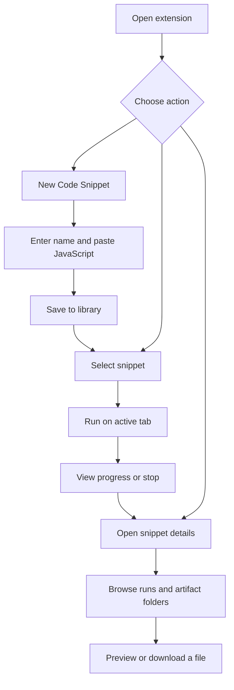
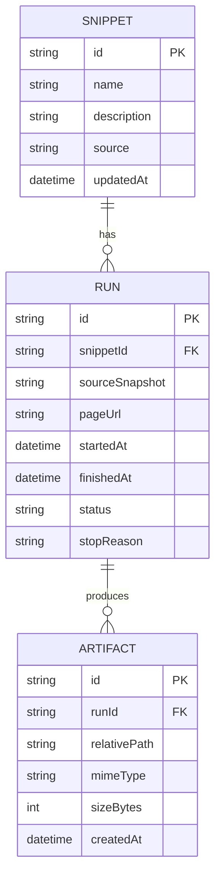
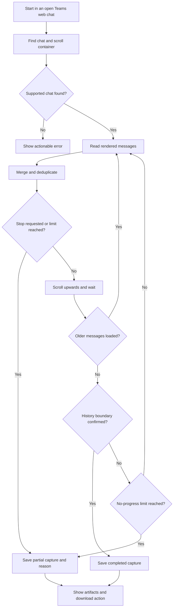
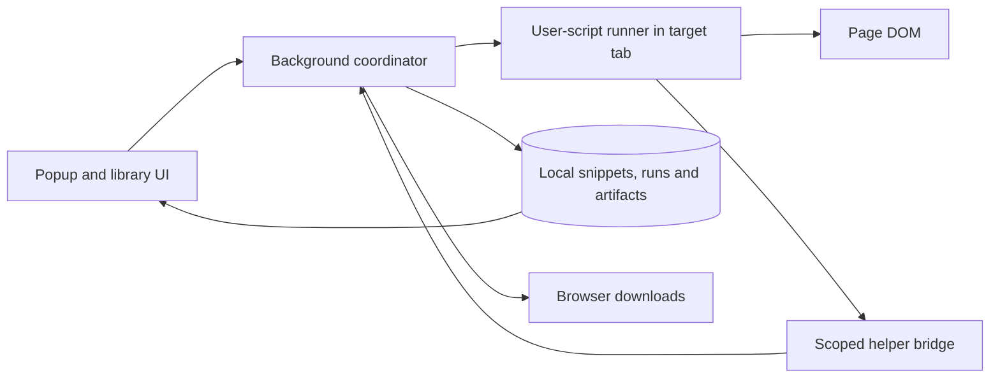

# Browser Code Snippets

A Chrome and Microsoft Edge extension for saving JavaScript snippets, running them against the current web page, and keeping the files they produce organised as **artifacts**.

The first use case is **Teams Chat Recorder**: run a snippet in an open Microsoft Teams web chat, collect messages while scrolling upwards to load older history, and save a local chat backup.

> **Project status:** working initial implementation in TypeScript, built with Vite and checked with Oxlint. Teams Chat Recorder is included as an editable starter snippet. Live Teams capture still needs verification against your signed-in chat interface.

## Build and install

Requires Node.js 22.12+ (Node.js 24 recommended) and npm.

```sh
npm ci
npm run check
```

1. Open `chrome://extensions` or `edge://extensions` and enable **Developer mode**.
2. Choose **Load unpacked** and select this project's `dist` folder.
3. Open the extension's details and enable **Allow User Scripts** if that switch is available. Older browser versions use Developer mode for this capability.
4. Pin **Browser Code Snippets** to the toolbar.
5. Open a regular web page, click the extension, and select a snippet. **Run saved snippet** requests access to that site when needed.
6. Choose **Open library** from that popup to open the larger editor while retaining the target tab.

The minimum declared Chromium version is 135, which introduces `userScripts.execute`. Current Chrome and Edge versions are the intended targets. Restricted browser pages and managed-browser policy may prevent execution.

For the first capture, open your chat in **Teams on the web**, wait for messages to load, then run the included **Teams Chat Recorder**. Its `CONFIG` object controls wait times, no-progress tolerance, and capture limits. Find its outputs in **Runs & artifacts** and choose **Download outputs** to save filesystem copies. “Stopped” is expected when the recorder cannot verify the beginning of history; check the summary for the capture reason.

| Command | Purpose |
| --- | --- |
| `npm run dev` | Rebuild on source changes. Reload the unpacked extension after rebuilding. |
| `npm run build` | Type-check and produce the installable `dist` directory. |
| `npm run lint` | Run Oxlint with warnings treated as errors. |
| `npm test` | Run storage, runner, and synthetic Teams tests with Vitest. |
| `npm run check` | Run lint, tests, and the production build. |
| `npm run test:browser` | Build and run a real-browser smoke test with a disposable Chromium profile. Requires Playwright Chromium (`npx playwright install chromium`). |

To exercise installed Edge, set `E2E_BROWSER=edge` when running `node scripts/browser-smoke.mjs`. The script uses the default Windows Edge executable path. Test files and screenshots stay under the ignored `artifacts/` directory. The smoke test uses synthetic chat content, never your signed-in Teams session.

### Implementation layout

```text
src/
  background.ts    Run coordination, validated helper bridge and downloads
  runner.ts        Async user-script wrapper and cooperative cancellation
  store.ts         IndexedDB storage for snippets, runs and artifacts
  paths.ts         Artifact and download path validation
  ui.ts            Popup, snippet editor, run history and inert previews
  style.css        Shared extension UI styles
snippets/
  teams-chat-recorder.js   Editable Teams starter, bundled as plain JavaScript
public/
  manifest.json    Manifest V3 configuration
tests/             Synthetic recorder, runner and storage tests
scripts/           Browser integration smoke test
```

### Current limits

- Artifacts are limited to **8 MiB per file**. Total available local storage depends on browser quotas; storage failures are reported to the run.
- Stop is cooperative. A snippet must yield to the event loop and check `snippet.signal.aborted`; reloading or closing the target tab interrupts execution. Existing checkpoints remain available.
- The extension marks a runner interrupted after three minutes without a heartbeat. Browser suspension or severe background-tab throttling can trigger this timeout.
- The Teams recorder exports all captures as partial because the supplied markup has no reliable beginning-of-history indicator. Attachment contents, rich cards, reactions, and threaded replies are not fully captured.
- Without a detectable chat header, a chat switch that reuses both the URL and viewport can go undetected. Keep the selected conversation open during capture.
- Binary artifacts can be downloaded; previews show text, Markdown source, and JSON as inert text. There is no rendered HTML preview.
- Snippets are JavaScript, while the extension implementation is TypeScript. There is no in-browser TypeScript compiler, module importer, or automatic snippet execution.

## What the extension should do

- Create a named code snippet by pasting JavaScript into an editor.
- Save, edit, rename, and delete snippets in a local library.
- Open the extension, select a snippet, and run it on the active tab.
- Show progress, logs, errors, and a Stop control for an active run.
- Let snippets save one or more artifacts through a shared helper API.
- Let snippets specify nested relative paths for those artifacts.
- Browse previous runs and artifacts from each snippet's detail view.
- Preview supported artifacts and download saved files again later.

Running a snippet should feel like executing code in the page's developer console, without requiring the user to open DevTools or paste the code each time. The implementation should use a browser-supported user-script execution mechanism; it does not need to automate the DevTools console.

## User workflow

1. Click the extension's toolbar icon.
2. Choose **New Code Snippet**.
3. Enter a name, optional description, and JavaScript code, then save.
4. Navigate to the page where the snippet should run.
5. Open the extension and click **Run** beside the snippet.
6. Follow progress or stop the run from the extension UI.
7. Open the snippet's **Artifacts** view to browse its saved outputs, grouped by run and folder.

Closing the popup should not cancel a run. Reopening it should reconnect to the current run's progress. Navigating away from, reloading, or closing the target tab should end the run and preserve any artifacts already saved.



## Extension interface

| View | Purpose |
| --- | --- |
| Toolbar popup | Find snippets, run one on the active tab, and see active-run status. |
| Snippet editor | Create or edit a snippet's name, description, code, and optional site restrictions. |
| Snippet details | Show run history and all artifacts belonging to that snippet. |
| Run details | Show the source page, start/end times, status, logs, and that run's artifact folders. |
| Artifact preview | Display text, Markdown source, or JSON and offer a download action. |

Use a full extension page for editing and browsing larger histories. Keep quick execution available in the popup.

## Snippets, runs, and artifacts

A **snippet** is saved code. A **run** is one execution of a particular saved version of that code. An **artifact** is a file produced by a run.

Each run records the snippet revision or source snapshot, target tab and URL, timestamps, outcome, and logs. Artifacts remain associated with that run and snippet even after the snippet is edited or renamed.



Run outcomes should distinguish **completed**, **stopped**, **failed**, and **interrupted**. An interrupted or failed run can still contain useful artifacts. Download success is recorded separately from successful artifact storage.

Deleting a snippet should explain whether its run history and artifacts will also be removed. Ordinary code edits must preserve existing outputs.

## Artifact helper API

Expose a small asynchronous API to running snippets. The extension supplies the `snippet` object; snippets do not need to implement storage or browser downloads themselves.

```javascript
// Paste this JavaScript into a snippet. Top-level await is supported.
snippet.log("Preparing export");
snippet.progress({ current: 12, total: 50, message: "Collecting messages" });

const artifact = await snippet.saveFile({
  path: "chats/project-alpha/messages.json",
  content: JSON.stringify({ messages: [] }, null, 2),
  mimeType: "application/json",
});

await snippet.saveFile({
  path: "chats/project-alpha/transcript.md",
  content: "# Project Alpha chat\n\nCaptured messages go here.\n",
  mimeType: "text/markdown",
});

// Optional explicit export of an already stored artifact.
await snippet.downloadFile(artifact.id);

// Long-running loops check the cancellation signal between operations.
if (snippet.signal.aborted) {
  // Save a partial result if useful, then exit.
}
```

### Saving and downloading

`saveFile()` stores the file content and metadata in the extension's local artifact library and resolves with an artifact record, including the final sanitised `path`. The file then appears under its snippet and run. Content may be a string, `Blob`, `ArrayBuffer`, or typed array. Use `overwrite: true` when updating an existing checkpoint path.

Downloading creates a filesystem copy of a stored artifact. A run can offer **Download outputs** at completion, while each artifact also has a download action in the library. A cancelled or failed download must leave the stored artifact available for retry. This keeps generated results available even when the user dismisses a download dialog.

If local storage fails or reaches its quota, `saveFile()` must reject with a clear error. The run must not report an artifact as saved before its content and metadata are committed.

### Folder paths

Paths are relative to the current run's artifact root. A snippet can create folders simply by saving a file with a nested path; a separate folder-creation call is unnecessary for the first version.

```text
Browser Code Snippets/
  Teams Chat Recorder/
    2026-10-29_093000_run-abc123/
      chats/
        project-alpha/
          messages.json
          transcript.md
          capture-summary.json
```

The library should support browsing these logical folders. Downloads should preserve the same hierarchy under the browser's Downloads location, using stable IDs alongside readable names where needed to avoid naming collisions.

Rules for artifact paths:

- Use `/` as the logical folder separator.
- Reject absolute paths, drive letters, empty filenames, and `.` or `..` path segments.
- Validate and sanitise filenames for supported operating systems, reporting any adjusted path.
- Scope all writes to the current run; snippets cannot overwrite another run's artifacts.
- Reject a duplicate path within a run by default; allow explicit replacement for checkpoint files.
- Resolve download filename collisions by creating a unique copy rather than silently replacing a file.

Chrome's downloads API supports filenames containing subdirectories relative to Downloads. Arbitrary absolute filesystem destinations are outside this initial design. See the [Chrome downloads API documentation](https://developer.chrome.com/docs/extensions/reference/api/downloads).

## First snippet: Teams Chat Recorder

### Purpose

Create a backup of the chat open in the Microsoft Teams web interface. The recorder reads rendered messages, scrolls upwards to reveal earlier history, and repeats until it reaches a stopping condition.

This is a capture of the history accessible through that interface. A successful run does not by itself prove that every historical message or attachment was captured.

### Capture process

1. Verify that the active page contains a supported Teams chat and identify its message scroll container.
2. Record the chat title or available identifier and the capture start time.
3. Collect the currently rendered messages before scrolling, since the interface may remove off-screen messages from the DOM.
4. Scroll upwards within the message container and wait for older messages to load.
5. Merge new messages into the accumulated collection, using Teams message IDs where available and a documented fallback identity otherwise.
6. Repeat while reporting message count and progress. Use bounded waits, a configurable no-progress limit, and an overall time or iteration limit.
7. Save the collected messages in chronological order, together with capture metadata and the reason the run stopped.



A lack of newly loaded messages can mean either the beginning of the chat or a loading problem. Unless a reliable history boundary is detected, mark the capture as partial and record the uncertainty.

### Message fields and output files

Capture the author, timestamp, message body, message ID, and visible edit/deletion indicators where available. Preserve useful visible links and attachment names/URLs. Missing fields should remain explicitly unavailable; do not invent timestamps or authors.

The first version should produce:

| Artifact | Contents |
| --- | --- |
| `chats/<chat-name>/messages.json` | Structured messages, available identifiers, and capture metadata. |
| `chats/<chat-name>/transcript.md` | A readable transcript in chronological order. |
| `chats/<chat-name>/capture-summary.json` | Chat details, capture times, message count, observed date range, stop reason, errors, and completeness assessment. |

Attachment links are references; downloading attachment contents is a separate future feature. Threaded replies and other message variants must be explicitly supported or reported as capture limitations.

### Resilience and stopping

- Deduplicate messages across overlapping scroll positions without merging distinct messages that happen to share text.
- Save periodic checkpoints so an interrupted tab does not discard all progress.
- On **Stop**, cease further scrolling and save a partial export when the runner is still available.
- Preserve the latest committed checkpoint if navigation, reload, or tab closure prevents finalisation.
- Detect a chat change during capture and stop before mixing conversations.
- Report selector failures and loading timeouts instead of silently claiming completion.

Teams DOM selectors and loading behaviour will need validation against the live interface during implementation. Keep Teams-specific extraction in the recorder rather than building it into the generic artifact service.

## Architecture

The Manifest V3 extension includes a popup, a full library/editor page, a background coordinator, and a page-side snippet runner. IndexedDB stores snippets, artifact content, and run history. Extension storage records initial starter-snippet setup.



The runner owns the active capture loop. The background coordinator routes commands and commits state; its in-memory state must not be the only record of a run. Reconcile persisted running records after browser restarts or lost runner connections and mark abandoned runs as interrupted.

Pasted JavaScript executes through `userScripts.execute` in a `USER_SCRIPT` world with messaging enabled. Chrome documents this API for arbitrary user code and requires its permission plus access to the target site. The extension checks API availability before starting. See the [Chrome userScripts documentation](https://developer.chrome.com/docs/extensions/reference/api/userScripts).

Chrome and Edge are target browsers. Confirm API support, user-script enablement, and any managed-browser restrictions in both before declaring compatibility. Request site access when needed, and show an explanation when a tab cannot run scripts.

The helper bridge must bind requests to the originating tab, snippet, and run. Validate payloads, paths, and size limits. Keep privileged storage and download operations behind that bridge; do not expose general extension privileges to snippets or the host page.

## Local data and execution

Snippets run only after an explicit user action in the first version. Show the target page before execution and allow optional site restrictions per snippet. Users should review pasted code because it can read or modify the page they run it on.

Keep the extension's artifact storage local by default, with no automatic cloud upload or synchronisation. The snippet's own JavaScript may make network requests, so local storage is not a guarantee about arbitrary snippet behaviour. Treat captured chat contents as private data and render artifact previews as inert content.

## First-version acceptance criteria

- A user can create, edit, and persist a snippet, restart the browser, and find it again.
- A saved snippet can run on a permitted active tab with progress and errors visible in the extension.
- Closing and reopening the popup preserves access to an active run.
- A snippet can save multiple artifacts with nested paths, and they appear under the correct snippet and run.
- Saved artifacts can be downloaded later with their folder structure preserved.
- Repeated runs remain separate, and snippet edits preserve earlier artifacts.
- Invalid paths, duplicate paths, quota failures, and download failures produce clear outcomes without claiming success.
- Teams Chat Recorder collects messages over multiple upward scrolls, handles overlapping rendered messages, and exports chronological JSON and Markdown.
- Stopping or interrupting a Teams capture preserves a partial result or the latest checkpoint and records why it ended.
- A loading stall is distinguishable from a confirmed beginning of history.
- A changed or unsupported Teams layout produces an actionable error.
- Core creation, execution, storage, and download workflows are verified in both Chrome and Edge.

## Later possibilities

- Import and export snippet definitions.
- Search, tags, and favourites in the snippet library.
- Configurable inputs for snippets, such as capture limits and output formats.
- Download all artifacts from a run as a ZIP archive.
- Attachment downloads and richer Teams message support.
- Additional recorders and page-export snippets using the same artifact API.

The browser smoke test exercises the generic page report and the Teams recorder on a synthetic chat fixture. It does not establish compatibility with every live Teams layout.
